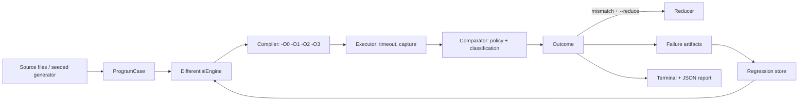

# CompilerCheck - Automated Compiler Verification Framework

CompilerCheck is a Python framework that compiles small C and C++ programs with Clang at
several optimization levels, runs every resulting binary, compares the observable behavior
and reports, classifies and preserves anything suspicious in a reproducible form.

> **Scope, honestly.** This is an educational compiler-verification framework built on an
> existing compiler. It is not a replacement for production compiler validation
> infrastructure, and it does not verify NVIDIA hardware, PTX, CUDA or proprietary NVIDIA
> compilers. It has found no compiler bugs; no such claims are made anywhere in this repository.

## 1. Problem statement

Optimizing compilers rewrite programs aggressively. For a program whose behavior is fully
defined by the language standard, every optimization level must produce the same observable
behavior. If `-O0` and `-O2` disagree, either the program is not as well defined as its
author believed, or the compiler (or runtime) has a defect. Telling these apart reliably,
automatically and reproducibly is the core of compiler verification.

## 2. Why compiler verification matters

A compiler bug is a bug in every program it compiles, and it is usually invisible: the
source is correct, the generated code is not. Differential testing (same program, different
configurations, compare results) is one of the cheapest ways to find such defects at scale,
and it needs careful infrastructure: controlled execution, a defensible comparison policy,
protection against false positives from undefined behavior, minimal reproducers and
regression tracking. CompilerCheck implements those pieces in a small, readable codebase.

## 3. Features

* Built-in smoke suite with hand-verified expected outputs, a seeded program generator
  (11 templates covering integer, signed/unsigned, loops, arrays, functions, structs,
  floating point, boundary and optimization-sensitive code, plus C++ templates and RAII),
  and loading of your own `.c` / `.cpp` files with per-file directives.
* Compiler abstraction: discovery, version query, explicit `-std=`, `-O0/-O1/-O2/-O3/-Os/-Oz`,
  captured diagnostics, durations, exit status and timeouts. No shell is ever used.
* Execution engine with timeouts, bounded output capture and crash (signal / NTSTATUS) detection.
* Differential engine with six outcomes: `PASS`, `MISMATCH`, `COMPILE_ERROR`, `TIMEOUT`,
  `CRASH`, `SKIPPED`; a documented comparison policy that normalizes nothing by default.
* Undefined-behavior safeguards: programs are classified `well_defined`,
  `undefined_behavior` or `invalid`; only well-defined programs are ordinary evidence, and
  an educational UB collection is kept separate.
* Bounded line-based test-case reduction that verifies the mismatch after every accepted step.
* Failure artifacts (source, minimized source, compiler, flags, platform, outputs, timings,
  seed, JSON metadata, reproduction instructions) and `rerun` from an artifact.
* Regression store with reviewable expected outcomes.
* Terminal summary and JSON reports; statistics are computed from actual results.
* Optional sanitizer mode (ASan / UBSan / TSan), separate from differential testing.
* GitHub Actions workflow, unit tests (test doubles only) and integration tests (real compiler).

## 4. Architecture



Data flow: a `ProgramCase` is compiled once per optimization level in a temporary
directory; each binary is executed; the list of `ConfigRun`s is compared against the first
configuration and any declared expectation; the outcome, differences and notes go to the
reporter and, for failures, to an artifact directory. Details: [docs/architecture.md](docs/architecture.md).

### Compiling, LLVM IR and machine code

*Compiling source code* is the whole translation of C/C++ text into something executable:
preprocessing, parsing, semantic analysis, optimization, code generation, assembling and
linking. Clang's front end lowers the AST to **LLVM IR**, a typed, target-independent,
SSA-form intermediate language (`clang -S -emit-llvm`). LLVM's optimizer (`-O1..-O3`)
transforms IR: inlining, constant folding, loop transformations, dead-code elimination and
more. The back end then lowers optimized IR to **machine code** for a specific target
(`clang -S` shows assembly; the assembler and linker produce the binary). CompilerCheck
currently observes only the *end result* (the running binary); IR/assembly inspection is a
listed future extension.

### Why optimization levels expose differences (and why that is not always a bug)

Higher levels apply more transformations, so latent problems show up there: miscompilations
in an optimization pass, or programs whose behavior depended on something the standard
leaves open. Signed overflow, out-of-bounds access, uninitialized reads, data races and
fast-math reassociation all let the optimizer legally choose different results. A mismatch
is a lead, never a verdict. See [docs/methodology.md](docs/methodology.md).

## 5. Supported platforms and prerequisites

* Python 3.11 or newer, no third-party runtime dependencies.
* Clang (preferred); any driver accepting the same flags works (`--compiler gcc` was used
  during development because the build environment had no Clang).
* Linux, macOS, Windows (see [docs/limitations.md](docs/limitations.md) for what has and has not been exercised).
* No GPU is required.

## 6. Installation

### Install Clang

* **Linux (Debian/Ubuntu):** `sudo apt install clang` (add `libclang-rt-dev` or your distro's compiler-rt package for sanitizers). Fedora: `sudo dnf install clang`.
* **macOS:** `xcode-select --install` (Apple Clang) or `brew install llvm`.
* **Windows:** `winget install LLVM.LLVM` (and add `C:\Program Files\LLVM\bin` to `PATH`), or install LLVM from <https://releases.llvm.org>. A working linker/CRT (Visual Studio Build Tools) is required for linking.

### Linux / macOS

```bash
unzip CompilerCheck.zip && cd CompilerCheck
python3 -m venv .venv
source .venv/bin/activate
python -m pip install -r requirements-dev.txt
python -m pip install -e .
python -m compilercheck doctor
```

### Windows (PowerShell)

```powershell
Expand-Archive CompilerCheck.zip -DestinationPath . ; cd CompilerCheck
py -3.11 -m venv .venv
.\.venv\Scripts\Activate.ps1
python -m pip install -r requirements-dev.txt
python -m pip install -e .
python -m compilercheck doctor
```

The package has no runtime dependencies, so `python -m compilercheck ...` also works from
the project root without installing. `pip install -e .` additionally provides a
`compilercheck` command.

## 7. Usage

Run all commands from the project root (the built-in suites live in `testcases/`; use
`--testcases-dir` otherwise). Output goes to `compilercheck-out/` (`--output-dir` to change).

```bash
python -m compilercheck doctor                       # prerequisites, compiler versions
python -m compilercheck run --suite smoke            # built-in smoke suite
python -m compilercheck run --source examples/c/arithmetic.c --optimizations O0 O2
python -m compilercheck run --suite generated --seed 42 --count 100
python -m compilercheck run --suite educational      # UB examples (implies --include-unsafe)
python -m compilercheck run --source my.c --reduce   # try to minimize any mismatch
python -m compilercheck rerun compilercheck-out/artifacts/<id>__mismatch [--minimized]
python -m compilercheck sanitize --suite smoke --sanitizers address undefined
python -m compilercheck regressions list
python -m compilercheck regressions run [--id ID]
python -m compilercheck regressions add --source file.c [--id ID] [--expected OUTCOME] [--note TEXT]
python -m compilercheck regressions add --from-artifact DIR [--minimized]
python -m compilercheck regressions update ID --accept
python -m compilercheck report --latest [--json] [--verbose]
```

Useful options (all subcommands that compile): `--compiler clang-17`, `--cxx-compiler`,
`--c-std c17`, `--cxx-std c++20`, `--compile-timeout`, `--run-timeout`, `--ignore-stderr`,
`--normalize-line-endings`, `--strip-trailing-whitespace`, `--config file.json`.
Pass optimization levels **without** a leading dash (`O0 O2`) so `argparse` does not read
them as options. `$COMPILERCHECK_COMPILER` sets the default compiler. A JSON config file
accepts the same names as the `Config` dataclass (for example `{"optimizations": ["O0","O3"], "c_std": "c17"}`).

### Exit codes

| Code | Meaning |
| --- | --- |
| 0 | All tests passed (skips allowed); regressions all as expected |
| 1 | At least one `MISMATCH` (or a regression whose outcome changed; sanitizer findings) |
| 2 | Usage error |
| 3 | Infrastructure problem: compiler missing, bad config, unreadable files, or nothing could be verified (everything skipped) |
| 4 | No mismatch, but compile errors, timeouts or crashes were found |

### Example output

The following was produced by an actual run in the development sandbox
(`COMPILERCHECK_COMPILER=gcc`, GCC 13.3.0 on Linux; Clang was not available there, so no
Clang output has been captured):

```text
$ python -m compilercheck run --source examples/c/arithmetic.c --optimizations O0 O2
[PASS         ] arithmetic  (0.16s)

CompilerCheck summary (suite: custom-sources)
Compiler                : gcc (Ubuntu 13.3.0-6ubuntu2~24.04.1) 13.3.0
Configurations tested   : 2 (O0, O2)
------------------------------------------------------------
Total tests             : 1
Successful (PASS)       : 1
Behavioral mismatches   : 0
Compilation failures    : 0
Timeouts                : 0
Crashes                 : 0
Skipped                 : 0
Total execution time    : 0.09 s
```

Numbers such as durations vary per machine. Example of the findings section, from the
educational suite in the same environment (these programs contain undefined behavior on
purpose, hence the caveat; the uninitialized value, and so the output, even varies from run to run):

```text
Findings:
  [MISMATCH] uninitialized: 3 difference(s): stdout
      stdout (O0 vs O1): -positive
      note: A mismatch is not proof of a compiler defect: rule out undefined behavior ...
      note: This program is declared undefined_behavior; its differences are NOT evidence of a compiler defect.
      artifact: compilercheck-out/artifacts/uninitialized__mismatch
```

## 8. JSON report format

`compilercheck-out/reports/report-<UTC timestamp>.json` (and a `latest.json` copy):

```jsonc
{
  "schema_version": 1,
  "tool": {"name": "compilercheck", "version": "0.1.0"},
  "run": {
    "suite": "custom-sources", "seed": null,
    "started_at": "...", "finished_at": "...",
    "optimizations": ["O0", "O2"],
    "compiler": {"executable": "gcc", "resolved": "/usr/bin/gcc", "version": "...", "cxx_executable": "g++"},
    "comparison_policy": {"normalize_line_endings": false, "strip_trailing_whitespace": false, "compare_stderr": true}
  },
  "summary": {"total": 1, "passed": 1, "mismatches": 0, "compile_errors": 0, "timeouts": 0,
              "crashes": 0, "skipped": 0, "unexpected_vs_expected_outcome": 0,
              "configurations": 2, "wall_seconds": 0.09},
  "results": [{
    "test_id": "arithmetic", "outcome": "PASS", "reason": "behavior agrees across 2 configuration(s)",
    "language": "c", "category": "integer_arithmetic", "safety": "well_defined", "seed": null,
    "expected_outcome": null, "differences": [], "notes": [],
    "configs": [{"name": "O0", "flags": ["-std=c11", "-O0"],
                 "compile": {"ok": true, "exit_code": 0, "timed_out": false, "seconds": 0.05, "stderr": ""},
                 "run": {"exit_code": 0, "signal": null, "crashed": false, "timed_out": false,
                         "seconds": 0.001, "stdout": "1092343948\n", "stderr": "", "output_truncated": false}}],
    "duration_seconds": 0.09, "minimized": false, "reduction": null, "artifact_dir": null
  }]
}
```

Streams in reports are clipped to 2000 characters; artifacts hold the complete output.

## 9. Adding test cases

Drop a `.c` / `.cpp` / `.cc` / `.cxx` file anywhere and pass it with `--source` (files or
directories). Optional directive comment in the first 30 lines:

```c
// compilercheck: category=arrays safety=well_defined expect_exit=0 timeout=5 float_tolerance=1e-9
// compilercheck: flags=-pthread,-fno-strict-aliasing description="what this tests"
```

Keys: `category`, `safety`, `expect_exit`, `timeout`, `compile_timeout`, `float_tolerance`,
`flags`, `description`, `id`. A sibling `<name>.expected` file holds the exact expected
stdout. Files without a `safety` directive are assumed well defined: that is your claim,
so check it (`sanitize`) before trusting a mismatch. To add a built-in generator template,
append a `Template` to `compilercheck/generator.py`.

## 10. Investigating a mismatch

1. Open the artifact directory printed in the report (`REPRODUCE.md`, `metadata.json`,
   per-level `*.stdout.txt`, `*.stderr.txt`, `*.compile.txt`).
2. `python -m compilercheck rerun <artifact> [--minimized]` to confirm it reproduces (flaky = suspect timing/ASLR).
3. `python -m compilercheck sanitize --source <artifact>/source.c` (or `--include-unsafe` if declared UB) to rule out UB the author missed.
4. Reread the source for implementation-defined/unspecified behavior and floating-point flags.
5. Reduce (`--reduce`) and inspect IR/assembly manually (`clang -S -emit-llvm -O2`).
6. Only then consider a compiler defect, and report it with the minimized source, exact compiler version and flags.

## 11. Regression testing

`regressions add` stores a program with an expected outcome (the current outcome unless
`--expected` is given) and the optimization levels used, under `regressions/<id>/`
(`case.json` + source). `regressions run` re-evaluates everything and exits 1 if any
outcome differs from the record; `--id` runs one. Expectations are data, not dogma: after
investigating (say the compiler was fixed), `regressions update ID --accept` records the new
outcome. The two shipped regressions are baselines, not discovered bugs:
`unsigned_wrap_baseline` (expects `PASS`) and `invalid_program_rejected` (expects `COMPILE_ERROR`).

## 12. Testing

```bash
python -m pytest tests/unit          # test doubles only; no compiler needed
python -m pytest tests/integration   # needs Clang; skipped with a reason otherwise
ruff check .
```

Set `COMPILERCHECK_TEST_COMPILER=gcc` to run the integration tests with another driver.
Unit tests cover command construction, discovery and missing compiler, compile
success/failure/timeouts, execution, normalization, exit-code comparison, mismatch detection
with deliberately different fake outputs (no real compiler bug is needed), JSON, artifacts,
regressions, deterministic generation and CLI exit codes. Tests are `unittest.TestCase`
classes, which both `pytest` and `python -m unittest discover -s tests -t .` run.

## 13. Continuous integration

`.github/workflows/ci.yml` runs on Ubuntu and macOS with Python 3.11 and 3.12: installs Clang
(apt on Linux, Apple Clang on macOS), installs dev dependencies, runs `ruff check`, unit
tests, integration tests, `doctor`, the smoke suite, a generated run (seed 42, 50 tests),
the regression suite, and uploads reports/artifacts. The workflow has not been run by the
author of this snapshot; no CI badge is included for that reason.

## 14. Known limitations and security

Running compiled programs is **not sandboxed**; timeouts are not a security boundary. Only
run trusted sources, or wrap the tool in an OS-level sandbox. Other limitations (single
compiler per run, black-box observation, line-based reducer, fixed generator templates,
platform coverage) are in [docs/limitations.md](docs/limitations.md).

## 15. Future extensions

* **LLVM IR analysis:** emit and diff IR/assembly across levels (`-emit-llvm`), run `opt` pass bisection, integrate `llvm-reduce`/C-Reduce for compiler-aware minimization.
* **CUDA/PTX integration:** a `CompilerLike` backend for NVRTC/`nvcc` that compiles kernels and compares results on a GPU or simulator. Not implemented; would require a GPU toolchain.
* **More backends:** GCC vs Clang cross-compiler comparison, different targets via emulators, parallel execution, grammar-based program generation (Csmith/YARPGen-style).

## 16. Contributing

1. Fork, create a branch, `pip install -r requirements-dev.txt && pip install -e .`.
2. Add tests with every change (`tests/unit` must pass without a compiler).
3. Run `ruff check .` and `python -m pytest`.
4. Keep documentation aligned with the implementation; do not add claims you cannot demonstrate.
5. Open a pull request describing the behavior change and how you verified it.

## 17. License

MIT, see [LICENSE](LICENSE).
