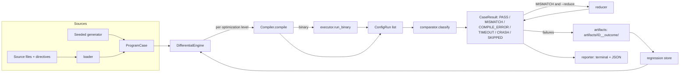

# Architecture

CompilerCheck is a pipeline of small modules with one responsibility each. Data moves
between them as plain dataclasses defined in `compilercheck/models.py`; there is no global
mutable state, and configuration is a frozen `Config` object passed explicitly.

| Module | Responsibility |
| --- | --- |
| `config.py` | `Config` and `ComparisonPolicy`: validated, explicit settings (CLI flags, optional JSON file). |
| `models.py` | `ProgramCase`, `CompileResult`, `ExecResult`, `ConfigRun`, `CaseResult`, `RunReport`, enums. |
| `loader.py` | Reads `.c/.cpp` files, `// compilercheck:` directives and `.expected` sidecars. |
| `generator.py` | Deterministic generator of well-defined programs, one `random.Random` per `(seed, index)`. |
| `compiler.py` | `Compiler`: driver discovery, version query, argv construction, `subprocess` invocation without a shell. |
| `executor.py` | `run_binary`: timeout, bounded output capture, crash/signal detection. |
| `comparator.py` | Comparison policy, text/float comparison, outcome classification. |
| `runner.py` | `DifferentialEngine`: compile under every level, execute, classify, optionally reduce, save artifacts. |
| `reducer.py` | Bounded line-oriented reduction driven by a predicate. |
| `artifacts.py` | Writes/reads failure artifact directories. |
| `regression.py` | `RegressionStore` and `run_regression`. |
| `reporter.py` | Summary statistics, JSON reports, terminal summary. |
| `sanitizers.py` | Optional ASan/UBSan/TSan runs, kept apart from differential testing. |
| `cli.py` | `argparse` front end, exit-code policy. |

## Data flow

1. A `ProgramCase` comes from a file or the generator. It carries its language, declared
   safety (`well_defined`, `undefined_behavior`, `invalid`), optional expected stdout/exit
   code, timeouts, extra flags and an optional floating-point tolerance.
2. `DifferentialEngine.evaluate` first applies the eligibility policy (only well-defined
   programs are ordinary evidence unless `--include-unsafe`), then writes the source to a
   temporary directory, compiles it once per optimization level and executes each binary.
3. `comparator.classify` turns the list of `ConfigRun`s into an outcome (see
   `docs/methodology.md`).
4. For failures, `artifacts.save_artifact` writes a self-contained directory; with
   `--reduce`, `reducer.reduce_source` first tries to shrink a mismatching source, with the
   engine itself as the predicate.
5. `reporter` computes all statistics from the `CaseResult`s and writes
   `reports/report-<timestamp>.json` plus a `latest.json` copy.

## Extension points

* **Another compiler:** `DifferentialEngine` only needs an object with `compile`,
  `build_command` and `describe` (the `CompilerLike` protocol). A CUDA/NVRTC/`nvcc` wrapper
  or an LLVM-IR pipeline can implement it; nothing in the comparator is Clang specific.
  No GPU backend exists today.
* **Another execution strategy:** pass a different `execute` callable (same signature as
  `run_binary`), for example one that runs under an emulator.
* **More templates:** add a `Template` to `generator.TEMPLATES`.
